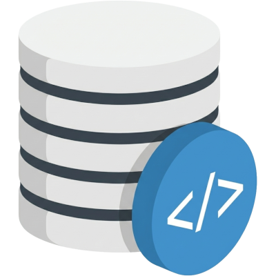

<div align="center">
  <a href="https://dml.beyondthecloud.dev">
    <picture>
      <source media="(prefers-color-scheme: dark)" srcset="./website/public/logo.png">
      
    </picture>
  </a>
  <h1><a href="https://dml.beyondthecloud.dev">DML Lib</a></h1>

<a href="https://beyondthecloud.dev"></a>


<a href="https://github.com/beyond-the-cloud-dev/dml-lib/blob/main/LICENSE"></a>


</div>

# Getting Started

DML Lib is a lightweight Apex library with a fluent API for DML operations: insert, update, upsert, delete, undelete, merge and publish platform events.

DML Lib is part of [Apex Fluently](https://apexfluently.beyondthecloud.dev/), a suite of production-ready Salesforce libraries by [Beyond the Cloud](https://blog.beyondthecloud.dev/blog).

## Why DML Lib?

- **Fluent API** - register records and commit them in one readable chain
- **Relationship handling** - parent IDs are set on child records automatically, in any registration order
- **Fewer DML statements** - records are grouped into one statement per object type
- **Security control** - user mode by default, system mode with or without sharing when you need it
- **Transactions** - roll back everything on failure with `commitTransaction()`, validate first with `dryRun()`
- **Detailed results** - successes, failures and errors for every operation and record
- **Mocking** - test DML logic without touching the database

## Examples

**Insert related records**

```apex
Account account = new Account(Name = 'Acme Corp');
Contact newContact = new Contact(LastName = 'Smith');

new DML()
    .toInsert(account)
    .toInsert(DML.Record(newContact).withRelationship(Contact.AccountId, account))
    .commitWork();

// newContact.AccountId is set to account.Id
```

**Combine operations in one unit of work**

```apex
new DML()
    .toInsert(newAccounts)
    .toUpdate(existingContacts)
    .toDelete(obsoleteTasks)
    .commitWork();
```

**Run in system mode**

```apex
new DML()
    .toUpdate(accounts)
    .systemMode()
    .withoutSharing()
    .commitWork();
```

**Mock DML in unit tests**

```apex
public class AccountService {
    public void createAccount() {
        new DML()
            .toInsert(new Account(Name = 'Acme'))
            .identifier('AccountService.createAccount')
            .commitWork();
    }
}
```

```apex
@IsTest
static void shouldCreateAccount() {
    DML.mock('AccountService.createAccount').allInserts();

    Test.startTest();
    new AccountService().createAccount();
    Test.stopTest();

    DML.Result result = DML.retrieveResultFor('AccountService.createAccount');
    Assert.areEqual(1, result.insertsOf(Account.SObjectType).successes().size());
}
```

## Installation

Install DML Lib as an unlocked package (`btcdev` namespace), as an unmanaged package, or deploy the source directly. Package links are on the [Installation](https://dml.beyondthecloud.dev/installation) page.

<a href="https://githubsfdeploy.herokuapp.com?owner=beyond-the-cloud-dev&repo=dml-lib&ref=main">
  
</a>

## Documentation

Everything else (all DML operations, mocking, results, configuration and advanced features) is covered in the [documentation](https://dml.beyondthecloud.dev).

## Contributors

<a href="https://github.com/beyond-the-cloud-dev/dml-lib/graphs/contributors">
  
</a>


## License notes:

- For proper license management each repository should contain a LICENSE file similar to this one.
- Each original class should contain a copyright mark: © Copyright 2026, Beyond The Cloud Sp. z o.o. (BeyondTheCloud.Dev)
